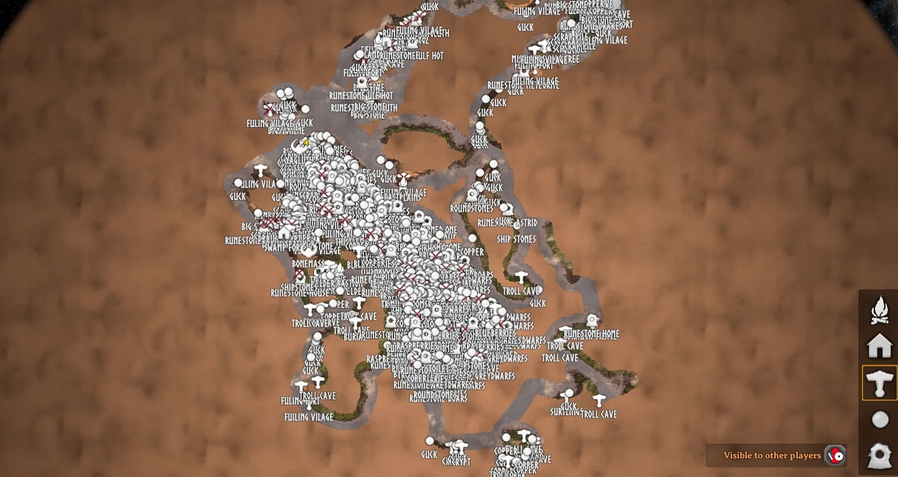
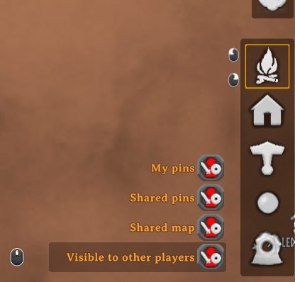

# HideFriendMapPings

Mod de BepInEx para Valheim que añade tres casillas al mapa grande: muestran / ocultan las zonas del mapa que exploraron otros jugadores (dejando solo lo que has explorado tú), los marcadores que te compartieron mediante la mesa de cartografía y tus propios marcadores. No se borra nada, solo cambia lo que se dibuja. Solo cliente.

[English version](README.md)

El motivo: tras leer la mesa de cartografía en un servidor con mucha gente, el mapa puede acabar así, y el juego solo permite ocultar todo lo compartido a la vez.





## Características

- Casilla **Mapa compartido**: oculta la niebla quitada por otros jugadores, en el mapa grande y en el minimapa.
- Casilla **Marcadores compartidos**: oculta los marcadores que tienen dueño (los leídos de la mesa de cartografía).
- Casilla **Mis marcadores**: oculta tus marcadores guardados sin dueño (los que pones, tumbas, jefes descubiertos). Los temporales (jugadores, pings, gritos, eventos, cama) nunca se ocultan.
- Son independientes entre sí. La casilla "Mesa de cartografía" del juego (que ocultaba mapa y marcadores compartidos a la vez) se oculta y queda sustituida por ellas.
- El estado se guarda en el archivo de configuración y se mantiene entre partidas.
- Los textos siguen el idioma del juego (14 idiomas, inglés por defecto).

## Cómo funciona

El código solo usa parches de Harmony y componentes de Unity. No accede a la red ni a archivos fuera del proceso del juego, salvo para escribir su propio archivo de configuración.

- `src/MapToggles.cs`: copia tres veces la casilla "Visible para otros jugadores" del juego y coloca las copias encima. Oculta el mapa compartido forzando a 0 el `_SharedFade` del shader del mapa, y oculta la casilla "Mesa de cartografía" del juego.
- `src/Patches.cs`: `Minimap.Start` crea las casillas, `Minimap.Update` aplica el fundido del mapa compartido y `Minimap.UpdatePins` cambia la lista de marcadores por una filtrada mientras se dibujan y luego la restaura.
- `src/Translations.cs`: registra los textos del mod en la localización de Valheim.
- `src/Plugin.cs`: punto de entrada de BepInEx y configuración.

## Compilar

Requisitos:

- [.NET SDK 8](https://dotnet.microsoft.com/download) o superior
- Valheim con [BepInExPack Valheim](https://thunderstore.io/c/valheim/p/denikson/BepInExPack_Valheim/) instalado (el proyecto usa los ensamblados del juego y de BepInEx de la carpeta de instalación)

Pasos:

```
git clone <este repositorio>
cd HideFriendMapPings
dotnet build -c Release -p:ValheimDir="C:\Program Files (x86)\Steam\steamapps\common\Valheim" -p:DeployToGame=false
```

El mod compilado es `bin/Release/HideFriendMapPings.dll`. `ValheimDir` vale por defecto la ruta de Steam de arriba. Sin `-p:DeployToGame=false`, la compilación también copia la DLL a `BepInEx/plugins/HideFriendMapPings/` de esa instalación.

Una compilación Release crea además los paquetes para subir en `release/`:

- `MapPinFilter-<versión>-nexus.zip`: `BepInEx/plugins/HideFriendMapPings/HideFriendMapPings.dll`, para descomprimir en la carpeta de Valheim.
- `MapPinFilter-<versión>-thunderstore.zip`: `manifest.json`, `README.md`, `icon.png` y la DLL, sacados de la carpeta `thunderstore/`.

Los textos de la página de Nexus Mods están en `nexus/`: `summary.txt` (resumen corto) y `description.bbcode` (descripción larga).

## Instalación

1. Instala BepInExPack Valheim.
2. Pon `HideFriendMapPings.dll` en `BepInEx/plugins/HideFriendMapPings/`.
3. Solo lo necesita el jugador que lo quiera usar.
